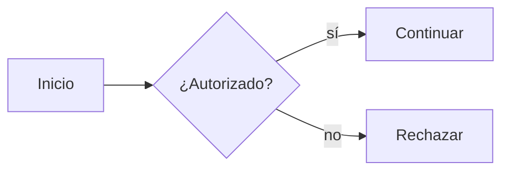
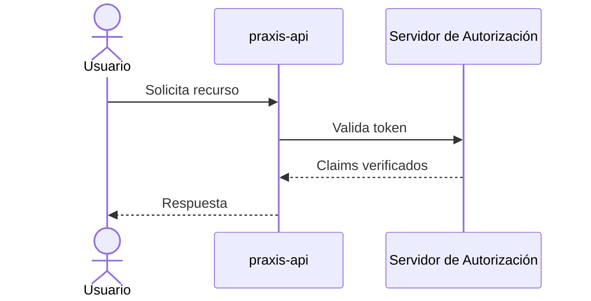
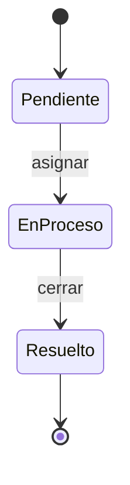
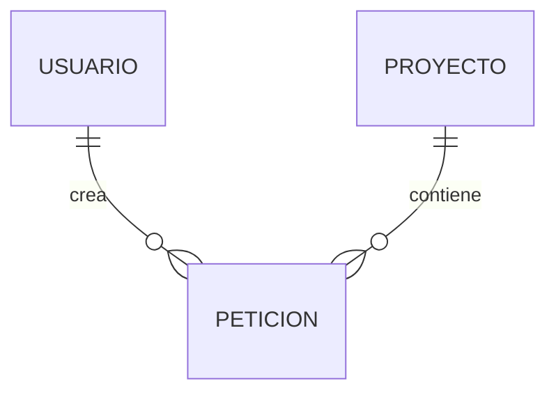
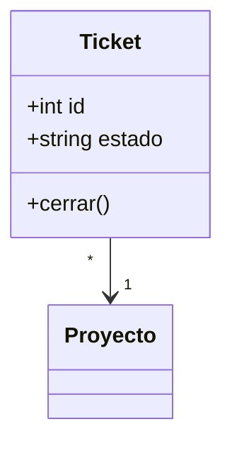

# Guía de diagramas (`.mmd` → `.png`)

Esta carpeta contiene los diagramas del proyecto como archivos **Mermaid**
(`.mmd`, el texto fuente) junto con su **imagen renderizada** (`.png`). Esta
guía explica cómo crear, mantener y exportar esos diagramas de forma
consistente.

> **Regla de oro:** el `.mmd` es la fuente de verdad. El `.png` siempre se
> **genera** a partir del `.mmd`; nunca se edita la imagen a mano. Si cambias el
> diagrama, edita el `.mmd` y vuelve a generar el `.png`.

---

## 1. ¿Qué es un archivo `.mmd`?

Un `.mmd` es un archivo de texto plano con la sintaxis de
[Mermaid](https://mermaid.js.org/): se describe el diagrama **con texto** y una
herramienta lo convierte en imagen. Al ser texto:

- Se versiona bien en git (los `diff` son legibles).
- Es fácil de revisar en un *pull request*.
- No requiere una herramienta gráfica para editarlo.

Ejemplo mínimo (`ejemplo.mmd`):



---

## 2. Convenciones del repositorio

Para que los diagramas se vean homogéneos, seguimos estas convenciones (puedes
verlas aplicadas en los archivos existentes de esta carpeta):

- **Idioma:** español. Los textos de nodos, notas y títulos van en español.
- **Nombres de archivo:** `kebab-case` descriptivo, con el sufijo `-es` para la
  variante en español (p. ej. `security-barriers-es.mmd`,
  `part1-auth-es.mmd`). Si en el futuro hay una variante en inglés, se nombra
  sin el sufijo (p. ej. `part1-auth.mmd`).
- **Pareja `.mmd` + `.png`:** cada diagrama tiene ambos archivos con el **mismo
  nombre base**. Al hacer commit, incluye los dos.
- **Título embebido:** cuando aplique, usa el bloque de *frontmatter* de Mermaid
  para el título, así queda dentro del propio diagrama:

  ```mermaid
  ---
  title: Barreras de seguridad (estado actual)
  ---
  flowchart TB
      ...
  ```

- **Estilos reutilizables:** define `classDef` al final del diagrama y asígnalos
  con `class` en lugar de repetir estilos nodo por nodo. Paleta sugerida:
  - barrera / control de seguridad: amarillo (`fill:#fff3cd`)
  - advertencia / riesgo: rojo (`fill:#f8d7da`)
  - elemento nuevo / propuesto: verde (`fill:#d4edda`)
  - fuente de datos / sistema externo: azul (`fill:#e8f4ff`)
- **Evita texto demasiado largo** dentro de un nodo; usa `<br/>` para cortar
  líneas y mantener el diagrama legible.

---

## 3. Requisitos para generar los `.png`

El renderizado usa [`@mermaid-js/mermaid-cli`](https://github.com/mermaid-js/mermaid-cli)
(el binario `mmdc`), que internamente usa un Chromium headless.

Necesitas **Node.js** instalado (incluye `npx`). Comprueba tu entorno:

```powershell
node --version
npx --version
```

No hace falta instalar nada de forma permanente: `npx -y` descarga la
herramienta la primera vez y la cachea.

> Si prefieres instalarla de forma global:
> `npm install -g @mermaid-js/mermaid-cli` y luego usa `mmdc` directamente.

---

## 4. Generar un `.png` desde un `.mmd`

Ejecuta los comandos **dentro de la carpeta `diagrams/`**.

### Un solo diagrama

```powershell
npx -y @mermaid-js/mermaid-cli -i mi-diagrama.mmd -o mi-diagrama.png -b white -s 2
```

Qué significan las opciones:

| Opción          | Significado                                                        |
| --------------- | ------------------------------------------------------------------ |
| `-i`            | archivo de entrada (`.mmd`)                                        |
| `-o`            | archivo de salida (`.png`, `.svg` o `.pdf` según la extensión)     |
| `-b white`      | fondo blanco (por defecto es transparente)                         |
| `-s 2`          | escala 2× → imagen más nítida (útil para documentación y zoom)     |

### Varios diagramas a la vez (todos los `.mmd` de la carpeta)

```powershell
Get-ChildItem *.mmd | ForEach-Object {
    npx -y @mermaid-js/mermaid-cli -i $_.Name -o ($_.BaseName + ".png") -b white -s 2
}
```

Esto regenera el `.png` de cada `.mmd` manteniendo el mismo nombre base. Es la
forma recomendada de **regenerar todo** tras cambios de estilo globales.

### Verificar el resultado

```powershell
Get-ChildItem *.mmd, *.png | Select-Object Name, Length, LastWriteTime
```

Revisa que cada `.mmd` tenga su `.png` con fecha de modificación reciente, y
abre la imagen para confirmar que se ve como esperas.

---

## 5. Flujo de trabajo recomendado

1. Crea o edita el archivo `.mmd`.
2. (Opcional) Previsualiza mientras editas:
   - en el editor, con una extensión de *preview* de Mermaid, o
   - en línea en el [Mermaid Live Editor](https://mermaid.live/).
3. Genera el `.png` con el comando de la sección 4.
4. Revisa la imagen.
5. Haz commit del **par** `.mmd` + `.png` juntos, con un mensaje que describa el
   cambio del diagrama.

---

## 6. Tipos de diagrama Mermaid útiles para documentar software

Mermaid cubre la mayoría de las vistas que se usan al diseñar y documentar
sistemas. Estos son los más habituales y cuándo conviene cada uno:

| Tipo Mermaid          | Palabra clave inicial         | Úsalo para…                                                                 |
| --------------------- | ----------------------------- | --------------------------------------------------------------------------- |
| Diagrama de flujo     | `flowchart` / `graph`         | Flujos lógicos, árboles de decisión, barreras de seguridad, arquitectura de alto nivel. |
| Diagrama de secuencia | `sequenceDiagram`             | Interacción temporal entre servicios/actores (p. ej. flujos OAuth, peticiones API). |
| Diagrama de estados   | `stateDiagram-v2`             | Máquinas de estado, ciclos de vida (p. ej. estados de un ticket o sesión).  |
| Diagrama de clases    | `classDiagram`                | Modelo orientado a objetos, relaciones entre entidades del dominio.         |
| Entidad-Relación      | `erDiagram`                   | Esquema de base de datos (tablas, claves, cardinalidades).                  |
| Diagrama C4           | `C4Context` / `C4Container`   | Arquitectura por niveles (contexto, contenedores, componentes).             |
| Diagrama de Gantt     | `gantt`                       | Planificación de tareas y cronogramas de proyecto.                          |
| Grafo de usuario      | `journey`                     | *User journey*: pasos y satisfacción del usuario en un recorrido.           |
| Gitgraph              | `gitGraph`                    | Estrategia de ramas y flujo de commits en git.                              |
| Mapa mental           | `mindmap`                     | Lluvia de ideas, descomposición de un concepto o funcionalidad.             |
| Diagrama de bloques   | `block-beta`                  | Vistas de arquitectura con bloques apilados/anidados.                        |
| Cuadrante             | `quadrantChart`               | Priorización (p. ej. esfuerzo vs. impacto, riesgo vs. probabilidad).        |

### Plantillas rápidas

**Secuencia** (ideal para flujos de autenticación/peticiones):



**Estados** (ciclo de vida):



**Entidad-Relación** (esquema de datos):



**Clases** (modelo de dominio):



---

## 7. Problemas comunes

- **`mmdc` no se encuentra:** usa la forma con `npx -y @mermaid-js/mermaid-cli`
  (no requiere instalación previa) o instala la CLI de forma global.
- **La descarga tarda la primera vez:** `npx` baja la herramienta y un Chromium
  headless; las siguientes ejecuciones son rápidas porque usan la caché.
- **La imagen sale con fondo transparente:** añade `-b white` (o el color que
  quieras).
- **Texto cortado o nodos demasiado grandes:** acorta los textos, usa `<br/>`
  para dividir líneas y revisa la dirección del diagrama (`TB`, `LR`, etc.).
- **Error de sintaxis al renderizar:** valida el diagrama primero en el
  [Mermaid Live Editor](https://mermaid.live/), que señala la línea del error.

---

## 8. Referencias

- Documentación oficial de Mermaid: https://mermaid.js.org/
- Editor en línea (previsualizar y depurar): https://mermaid.live/
- CLI de renderizado: https://github.com/mermaid-js/mermaid-cli
